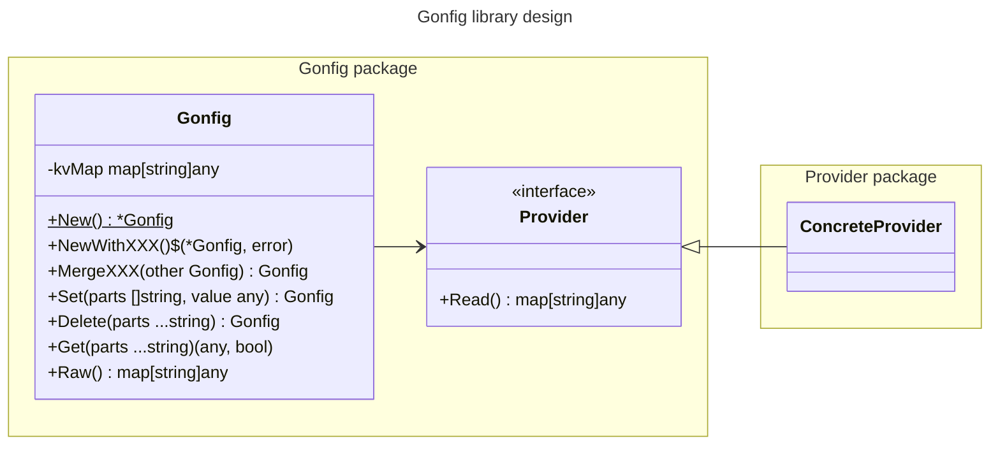

# Design Idea
Main doc that describes the idea from a technical perspective.

# Domain terms
- **key-value pair(s)** — refers to a configuration key together with its value.
- **Gonfig** — the configuration container type; its methods are listed under Collection methods and Access methods by key, and its constructors are `New` and `NewWithXXX`.
- **Provider** — an abstraction of a collection of key-value pairs for Gonfig.
- **copy-contract** — the rule for every value that crosses the `Gonfig` boundary: every accepted or returned
  item is a deep copy, so no caller can modify the container's internal state through a reference.
- **deep copy** — if a value is a map or another reference type, a new copy is created for it.

## Diagram



# Gonfig module
Gonfig provides isolation through its **copy-contract**. Every method that accepts or returns a collection of
key-value pairs creates a deep copy to protect against changes through the passed or returned reference.
`Raw()` and `Get` return deep copies for the same reason, so a returned map can be modified without affecting
the container.


## Collection methods
- `New()` — creates an empty `Gonfig`; the zero value is already ready to use, so it is optional and
  exists for symmetry with the `NewWithXXX` family.
- `NewWithXXX` — inbound constructor functions that create the `Gonfig` struct and fill it with the initial or provided
  **key-value pair(s)**.
- `MergeXXX` — inbound instance functions (functions with a receiver) that accept the value for the current `Gonfig` struct.

`NewWithProvider` returns the `ErrNilProvider` sentinel when its provider argument is nil, so a wiring mistake
cannot be mistaken for an empty configuration.

The `XXX` suffix only emulates overloading; Go has no method overloading.

The main difference between `NewWithXXX` and `MergeXXX` is that `NewWithXXX` creates and initializes the `Gonfig` struct,
whereas `MergeXXX` applies the provided key-value pairs to the existing `Gonfig` struct.

- `Raw()` — returns a deep copy of the internal map, as the copy-contract requires.


## Access methods by key

If key is empty, nil or not specified, nil will be returned,
otherwise the specified value.

`Get` returns a deep copy of the value at the key, together with whether the key was found; a returned map
can be modified without affecting the container.

- `Get` — deep copy of the value by the provided key, together with whether the key was found; a returned
  map may be modified freely
- `Set` — value which was set by the provided key
- `Delete` — value which were removed by the provided key 


## Gonfig internal storage
The internal storage of `Gonfig` is a nested `map[string]any`, guarded by a `sync.RWMutex`.


# Provider

The main source of key-value pairs is the `Provider` abstraction, with a single function:
```go
type Provider interface {
Read() map[string]any
}
```
Each provider module is a separate package.

# Questions to answer later
- Should the provider interface return an error, or will an empty map be enough?
