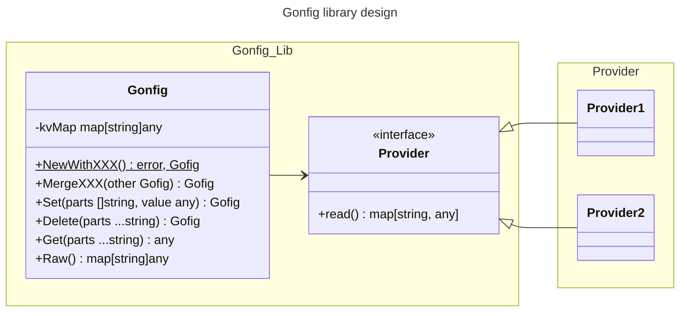

# Model

There main entities are:
 * Provider - main supplier of key-value collection.
 * Gofig - main struct with number of methods that provides a management functionality for the configuration
 * gofig tag - marks the struct field

## Key-value collection
Key value collection is represented by `key:string, value:any`. 
**Note!** value may be also a nested map with type `key:any, value:any`, in this case keys 
will be normalized to a string type.

## Provider
An interface that has only one simple method `Read() (map[string]any, error)`. 

## Gofig
Main key-value collection manager, which server for the following responsibilities for key-value collection:
* NewWithXXX - where XXX is the source suffix and
* merge - collect key-values from different sources
* writing - write to different type of sources

# Architecture

Library is implemented with modular approach: 
* Every provider is a separate module, which is included only when it is needed.
* Cor module has only a std lib dependency
  

# Diagram

