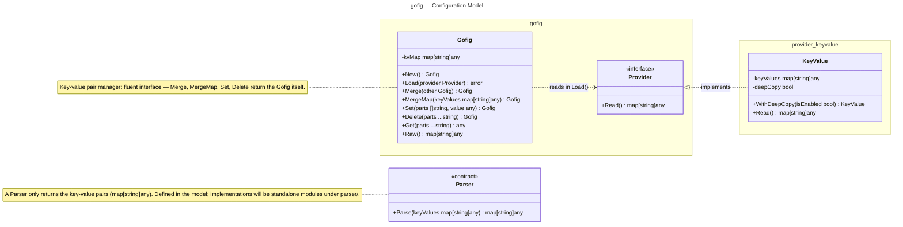

# Configuration Model

Mermaid class diagram of the gofig configuration model.

Value-returning methods (`Read`, `Parse`, `Get`) also return a second result —
an error, and for `Get` a found flag — omitted from the signatures below to
keep the diagram readable.

